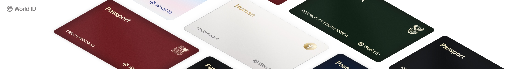

# World ID Proof Verification Service

A small HTTP service that verifies **World ID** zero-knowledge proofs of ownership of WorldID account.

It validates [Semaphore](https://semaphore.pse.dev/) inclusion proofs (via
[`semaphore-rs`](https://crates.io/crates/semaphore-rs)) against a challenge timestamp, returning
whether a submitted proof is accepted. It is built on [`axum`](https://github.com/tokio-rs/axum)
(tokio / tower / hyper) and emits traces and metrics to Datadog through `telemetry-batteries`.

## How it works

A client submits a proof together with an RFC 3339 challenge timestamp. The service:

1. Rejects timestamps that are in the future (beyond a small clock-skew tolerance).
2. Rejects timestamps older than `RESPONSE_DURATION_SECONDS` (default 300s).
3. Verifies the Semaphore inclusion proof.

It responds with one of: `proof_accepted`, `proof_rejected`, `old_timestamp`,
`timestamp_is_in_the_future`, or `wrong_timestamp_format`.

## API

The server listens on `0.0.0.0:8080`.

| Method | Route             | Description                                                      |
|--------|-------------------|------------------------------------------------------------------|
| `POST` | `/api/v1/verify`  | Verify a World ID / Semaphore proof against a challenge.         |
| `POST` | `/api/v4/verify`  | Verify a World ID 4.x ownership proof against a single-use challenge. **Requires JWT auth** (`Authorization: Bearer`), see [Authentication](#authentication). |
| `POST` | `/api/v4/zkp/challenge/{challenge_type}` | Issue a single-use challenge. Supported types: `enrollment`, `teedi_migration`. |
| `GET`  | `/health`         | Liveness check; returns service name and version (no dependency checks).  |
| `GET`  | `/ready`          | Readiness check; `200` when the nonce-store Redis answers `PING`, `503` otherwise. |
| `POST` | `/api/v1/gen`     | **Optional**, test/staging only — generate a proof. Disabled by default; enabled only when `ENABLE_PROOF_GEN_ENDPOINT=true`. |

> Note: the verification routes are `POST /api/v1/verify` and `POST /api/v4/verify`. There is **no** bare `/verify` route.

`/api/v4/verify` returns a coarse verdict only — `{"msg":"proof_accepted"}` (`200`) or
`{"msg":"proof_rejected"}` (`401`), with no internal reason. The challenge nonce is only
consumed on a **successful** verification (single success, enforced by an atomic
`GETDEL`); a failed check (unknown/expired challenge, unaccepted
root, invalid proof) leaves it intact so it can be retried until it expires. A dependency
that cannot give a verdict (gateway or nonce store unreachable) returns `503`.

The request body is `{"challenge_id": "<uuid>", "credential_sub": "0x<64 hex>",
"proof": "<base64>"}`, where `proof` is the CBOR encoding of the WIP-103
`OwnershipProof` (walletkit's `OwnershipProof::encode()`) in standard, padded
base64 — ~760 KiB for a real proof. A blob that fails base64 or CBOR decoding
gets a coarse `400`; an oversized body or proof component gets `413`.

## Authentication

`POST /api/v4/verify` is not public: verifier backends authenticate with a JWT.
There is **no JWKS endpoint** — the accepted keys are static configuration.

- **Transport.** `Authorization: Bearer <jwt>`.
- **Algorithm.** ES256 (ECDSA P-256) only; any other `alg` (including `none`) is rejected.
- **Claims.** `sub` (the calling service's name, required) and `exp` (required);
  `nbf` is honoured when present. A small clock-skew leeway is allowed on the
  time-based claims. Issuer/audience are not checked — identity is bound by key.
- **Identity binding.** `JWT_TRUSTED_KEYS` maps each service name to its public
  key(s). A token is accepted only if its signature verifies against the key
  registered for **its own** `sub`, so one trusted caller cannot impersonate
  another.
- **Key rotation.** Each service may configure a `current` and an optional
  `previous` key; both are accepted, giving a zero-downtime overlap window.
  Rotate by promoting `current`→`previous`, setting the new `current`, and
  redeploying; drop `previous` once every caller has switched.
- **Rejection.** Missing, malformed, wrong-algorithm, unknown-`sub`,
  wrong-signature, expired, or not-yet-valid tokens all get a coarse `401`
  (`{"msg":"unauthorized"}`) that never discloses which check failed; the failure
  class is emitted in structured logs and as a metric tag. A rejected request never touches the
  nonce store, gateway, or verifier.
- **Fail-closed boot.** The service refuses to start unless `JWT_TRUSTED_KEYS`
  configures at least one valid key.

Client-side token minting (e.g. signing via AWS KMS) is the caller's
responsibility and lives outside this service.

### Example

```bash
curl -i -X POST http://localhost:8080/api/v1/verify \
  -H 'Content-Type: application/json' \
  -d '{ "challenge": "2026-06-16T12:00:00Z", "...": "proof fields" }'

curl -i http://localhost:8080/health
```

## Build

Requires a Rust toolchain (the project is built and tested against **Rust 1.95.0**) and the usual
system build dependencies (`build-essential`, `libssl-dev`, `pkg-config`). OpenSSL is built
vendored, so no system OpenSSL dev headers are strictly required at link time.

The `/api/v4/verify` path enables `world-id-proof`'s `embed-ownership-verifier` feature, whose
build script compiles the bundled Noir ownership circuit. This makes the **Noir toolchain
(`nargo`, v1.0.0-beta.26) a build-time requirement**, and the build fetches the circuit's
Noir dependencies from git, so network access is needed at build time. Install with:

```bash
curl -fsSL https://raw.githubusercontent.com/noir-lang/noirup/main/install -o /tmp/noirup-install.sh
bash /tmp/noirup-install.sh
noirup --version 1.0.0-beta.26
```

```bash
cargo build --release
```

Ownership verification uses `world-id-proof` **0.18.0** (ProveKit **1.0.3**).
The HTTP request/response format is unchanged, but **ownership proofs generated with 0.14.0
are incompatible**: a real proof accepted by 0.14.0 was rejected by the 0.18.0 release verifier
with `Verification("while verifying sumcheck")`. Coordinate the prover upgrade with callers
before deploying this version, or retain a separate legacy verification path.
`cargo test --release --locked --example verify_bench` checks a real 0.18.0 proof's CBOR
roundtrip, input binding, tamper rejection, and compatibility with the existing size limits.

### Known limitation: ownership verification in debug builds

In debug builds (`cargo run`), a valid ownership proof received over HTTP can panic during
verification and return **503**. ProveKit's debug verifier expects a transcript interaction
`pattern`, but that diagnostic metadata is deliberately omitted when proofs are serialized.
Decoding the normal wire format therefore leaves the pattern empty and triggers an upstream
assertion. For local end-to-end ownership verification, use `cargo run --release`.
The Docker image already uses a release build, where these debug checks are compiled out.

The debug ownership-proof regression test restores the original in-memory pattern after
decoding, so it does not cover this HTTP failure. The release regression test verifies the
serialized proof without restoring metadata. Fixing debug verification is deferred until the
upstream verifier supports absent diagnostic metadata while retaining its cryptographic checks.

## Run

```bash
# Defaults are production-oriented; override via flags or environment variables.
cargo run --release
# binary then listens on 0.0.0.0:8080
```

Configuration is read from CLI flags or environment variables (see `src/cfg/config.rs`):

| Env var                      | Default       | Description                                                  |
|------------------------------|---------------|--------------------------------------------------------------|
| `SRV_ENV`                    | `prod`        | Deployment environment (`prod`, `staging`, `dev`).           |
| `SRV_NAME`                   | crate name    | Service name reported by `/health` and telemetry.            |
| `SRV_VERSION`                | crate version | Service version reported by `/health`.                       |
| `DD_AGENT_HOST`              | `127.0.0.1`   | Datadog agent host.                                          |
| `DD_AGENT_PORT`              | `8126`        | Datadog APM trace-intake port.                              |
| `DD_STATSD_PORT`             | `8125`        | DogStatsD metrics port.                                     |
| `RESPONSE_DURATION_SECONDS`  | `300`         | Max accepted age (seconds) of a challenge timestamp.        |
| `RUST_LOG`                   | `info`        | Log level.                                                  |
| `ENABLE_PROOF_GEN_ENDPOINT`  | `false`       | Enable the test-only `POST /api/v1/gen` endpoint.            |
| `REDIS_URL`                  | `redis://127.0.0.1:6379` | Redis connection URL for the single-use nonce store. Carries scheme, host, optional AUTH (`redis://:password@host`) and optional TLS (`rediss://`). |
| `REDIS_COMMAND_TIMEOUT_MS`   | `2000`        | Per-command (and connect) Redis deadline, in ms. Bounds how long a slow/unreachable Redis blocks a request before it **fails closed**. |
| `GATEWAY_URL`                | — (required)  | Base URL of the World ID gateway exposing `GET /is-valid-root`. **No default** — the service refuses to start if unset. Must point at a real gateway, not this service's own bind port (`8080`). |
| `GATEWAY_TIMEOUT`            | `2s`          | Per-request deadline for the gateway call (humantime, e.g. `2s`, `500ms`). |
| `JWT_TRUSTED_KEYS`           | — (required)  | Trusted JWT public keys for `POST /api/v4/verify`, as a JSON object mapping each service name (`sub`) to `{"current": "<PEM SPKI>", "previous"?: "<PEM SPKI>"}`. **No default** — the service refuses to start if unset, empty, or holding an invalid key. See [Authentication](#authentication). |

A Datadog agent is expected at `DD_AGENT_HOST` for telemetry export.

### Redis nonce store

Challenge/verify replay-resistance is backed by a single-use nonce stored in
Redis: written once with `SET … NX EX <ttl>` and consumed at most once with an
atomic `GETDEL`, so two concurrent verifications of the same challenge can never
both succeed. If Redis is unavailable the store **fails closed** — issuance
returns `503` and consumption rejects. `REDIS_URL` selects plain / AUTH / TLS
connectivity; `REDIS_COMMAND_TIMEOUT_MS` bounds every command.

## Local development

Bring up Redis using the provided Compose file, which exposes it on localhost
port 6380. Copy `env.local.example` to `env.local` to configure the Rust service
with the matching `REDIS_URL`. Load this configuration through direnv before
starting the service; `.envrc` reads `env.local`. Compose starts Redis but does
not load configuration into a separately launched Rust process.

```bash
cp env.local.example env.local
docker compose up -d redis      # start Redis (published on 6380)
docker compose ps               # confirm it is healthy
docker compose down             # stop and remove it when done
```

## Test

```bash
cargo test
```

Some nonce-store tests need a live Redis. Start it first (the tests default to
`redis://127.0.0.1:6380`, matching the Compose port); set `REDIS_URL` to point
elsewhere:

```bash
docker compose up -d redis
cargo test
```

CI runs a Redis service container on the same port, so these tests execute on
every build.

## Lint

CI enforces formatting and a zero-warnings clippy bar. Run the same checks locally:

```bash
cargo fmt --all --check
cargo clippy --all-targets --all-features -- -D warnings
```

## Supply chain

Dependencies are audited (`cargo audit`) and policy-checked (`cargo deny check`, see `deny.toml`)
in CI. The `semaphore-rs` crate — which performs the actual proof verification — is pinned to an
exact version so the cryptographic verification path cannot float across releases.

## Container

```bash
docker build -t world-id-proof-verification-service .
```

## License

[MIT](./LICENSE)
